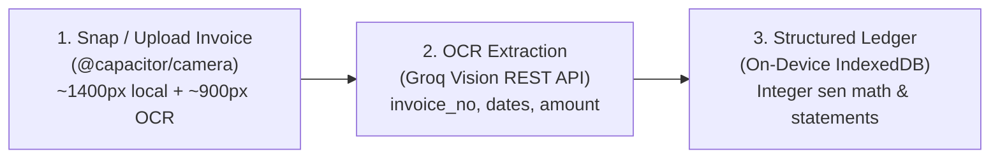
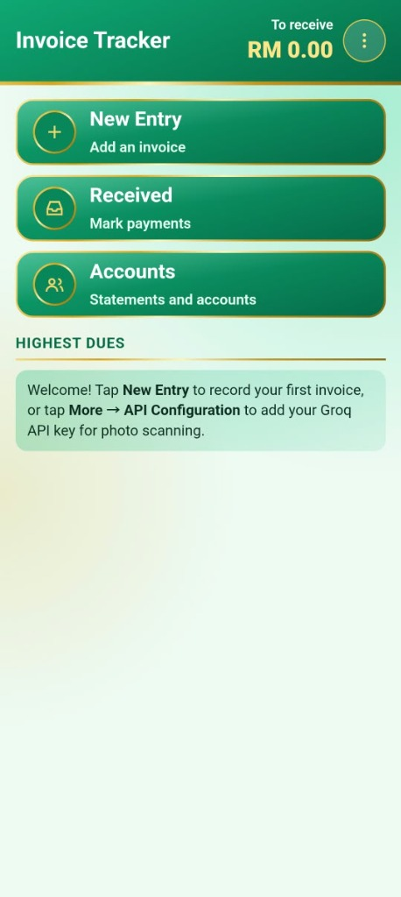
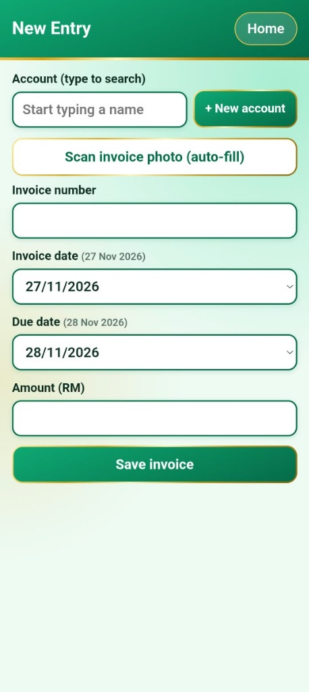
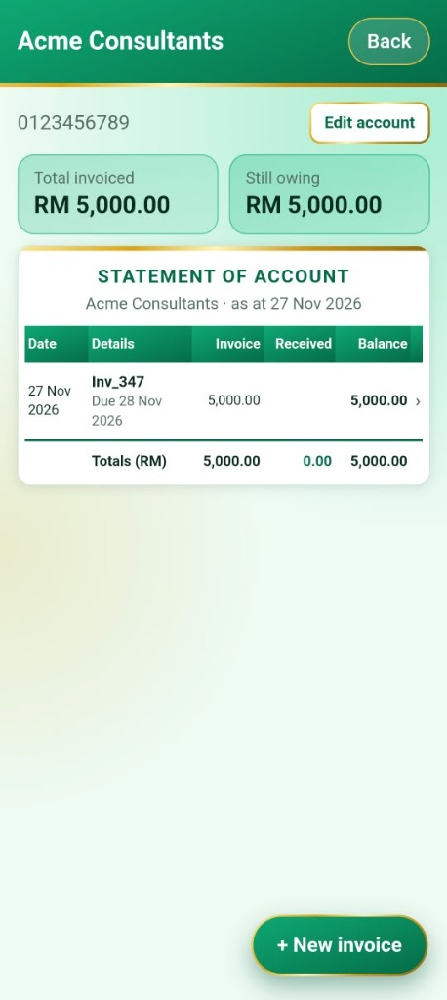
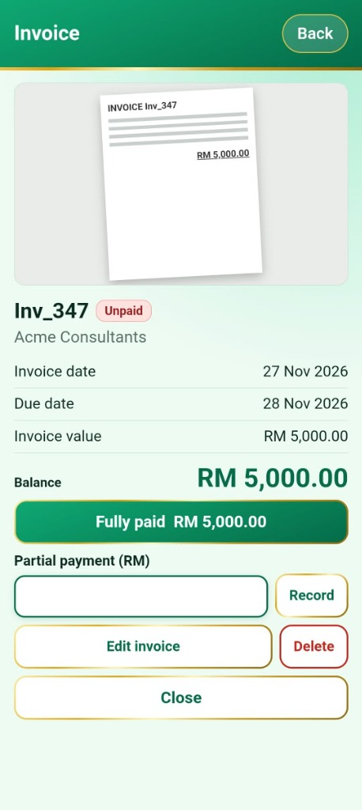
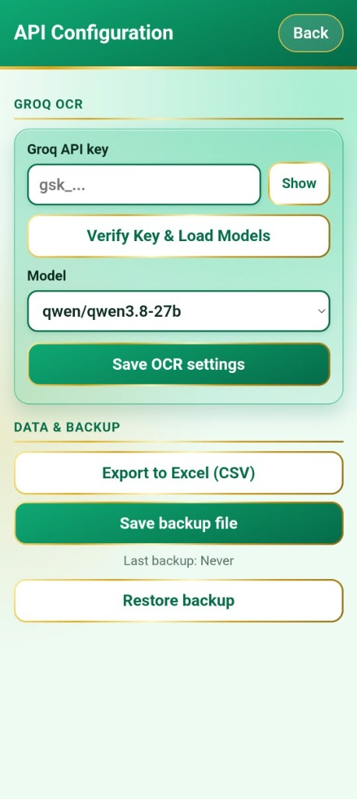

# Invoice Tracker

An **offline-first Android invoice & payment ledger** built with Capacitor, IndexedDB, and client-side Groq Vision OCR. Designed for single-device shop and small-business accounting in MYR (`RM`) with a light-only emerald and gold interface, zero external backend, and zero hosting cost.

---

## Architecture Flow (3 Steps)



1. **Snap / Upload Invoice:** Capture a photo with the camera or pick from the gallery via `@capacitor/camera`. The app saves a compressed **~1400px** JPEG locally for pinch-to-zoom viewing and prepares a lighter **~900px** JPEG for fast inference.
2. **OCR Extraction:** Sends the ~900px image directly from the device to the **Groq Vision API** (`POST https://api.groq.com/openai/v1/chat/completions`, default `qwen/qwen3.8-27b`) using your own API key. Extracts only `invoice_no`, `invoice_date`, `due_date`, and `amount` (never auto-filling the customer account), with clean offline/timeout fallback to manual entry.
3. **Structured Ledger:** Stores all accounts, invoices, payments, and photos locally in **IndexedDB** (`invoice_tracker_db`) using **integer `sen` math** to prevent floating-point rounding bugs, updating running account statements, overdue statuses, and daily cash reports in real time.

---

## Key Features

- **Offline-First On-Device Ledger:** Works 100% offline for recording accounts, invoices, full/partial payments, and viewing running statements (only photo OCR requires internet).
- **Groq Vision Auto-Fill & Live Model Selector:** Verify your Groq API key in **More → API Configuration**, dynamically load vision-capable models, and auto-fill invoice details in seconds.
- **Statement of Account & Full-Screen Zoom:** Fixed-layout running statement per customer (`Date`, `Details`, `Invoice`, `Received`, `Balance`), full CRUD for accounts/invoices/payments, and a pinch-to-zoom invoice photo viewer.
- **Day Ending Report & WhatsApp Quick-Share:** Generates a chronological `Cash Sales Due Report Day (DD MMM YYYY)` and lets you share an account's open (`Unpaid` / `Partial`) invoices directly via the Android Share Sheet.
- **PIN & Biometric App Lock:** Optional 4-digit PIN (SHA-256 hashed locally) with offline Security Question recovery and biometrics-only Android Fingerprint unlock (`@capgo/capacitor-native-biometric`) protecting app launch and API Configuration.
- **CSV Export & Portable JSON Backups:** Export Excel-ready CSVs or full JSON backups (including photos, settings, and security config) via the Android Share Sheet, with one-tap JSON restore.

---

## Mobile Screenshots

<table>
  <tr>
    <td align="center"><br/><sub><b>Home</b></sub></td>
    <td align="center"><br/><sub><b>New Entry &amp; OCR</b></sub></td>
    <td align="center"><br/><sub><b>Statement of Account</b></sub></td>
  </tr>
  <tr>
    <td align="center"><br/><sub><b>Invoice Detail</b></sub></td>
    <td align="center"><br/><sub><b>More Menu</b></sub></td>
    <td align="center"><br/><sub><b>API Config &amp; Backups</b></sub></td>
  </tr>
</table>

---

## Repository Layout

```text
.
├── README.md
├── .gitignore
├── screenshots/                                # Mobile UI screenshots used in README
└── invoice-handover/
    ├── ui-reference/
    │   └── index.html                          # Original approved static UI prototype (sample data)
    └── android-wrapper/
        ├── build.sh                            # Automated setup, AndroidManifest permissions & APK build script
        ├── capacitor.config.json               # Capacitor appId (com.shop.invoicetracker) & webDir (www)
        ├── package.json                        # Capacitor 6 & native plugin dependencies
        ├── www/
        │   ├── index.html                      # Production web app (IndexedDB, Groq OCR, Reports, Security)
        │   ├── icon-192.png                    # App icon (192x192)
        │   └── icon-512.png                    # App icon & splash logo (512x512)
        └── android/                            # Generated Capacitor Android Gradle project
            └── app/
                ├── build.gradle                # Android app config & release signingHooks
                └── src/main/
                    ├── AndroidManifest.xml     # Camera, Storage, Internet & Biometric permissions
                    └── res/                    # Adaptive launcher icons & light-only styles.xml
```

---

## Tech Stack

- **Mobile Wrapper:** Capacitor 6 (`@capacitor/android`, `@capacitor/app`, `@capacitor/camera`, `@capacitor/filesystem`, `@capacitor/share`, `@capgo/capacitor-native-biometric`)
- **Frontend:** Vanilla HTML, CSS, and JavaScript ([`invoice-handover/android-wrapper/www/index.html`](invoice-handover/android-wrapper/www/index.html))
- **Storage:** IndexedDB (`invoice_tracker_db`) with integer `sen` currency arithmetic
- **OCR:** Groq Vision REST API (`https://api.groq.com/openai/v1/chat/completions`)

---

## Build & Run

**Prerequisites:** Node.js, JDK 17, and Android SDK (`platforms;android-34`, `build-tools;34.0.0`).

```bash
cd invoice-handover/android-wrapper
npm install
npx cap sync android

# Build Debug APK
cd android && ./gradlew assembleDebug

# Or run the all-in-one build script
./build.sh
```

To build a **Signed Release APK** (`./gradlew assembleRelease`), place your `*.jks` keystore and `keystore.properties` inside `invoice-handover/android-wrapper/android/` (both are ignored by `.gitignore`).

**APK Outputs:**
- Debug: `invoice-handover/android-wrapper/android/app/build/outputs/apk/debug/app-debug.apk`
- Release: `invoice-handover/android-wrapper/android/app/build/outputs/apk/release/app-release.apk`

---

## Data, Backups & Keystore Safety

- **On-Device Privacy:** All customer accounts, invoices, payments, compressed photos, and API keys stay locally on your phone in IndexedDB.
- **Regular Backups:** Use **More → API Configuration → Save backup file** to export a full JSON backup to Google Drive or WhatsApp.
- **Keystore Safety:** Never commit `*.jks`, `*.keystore`, or `keystore.properties` to Git. Keep your release keystore backed up safely outside the repository—future APK updates must be signed with the exact same key to install over an existing app without losing data.
